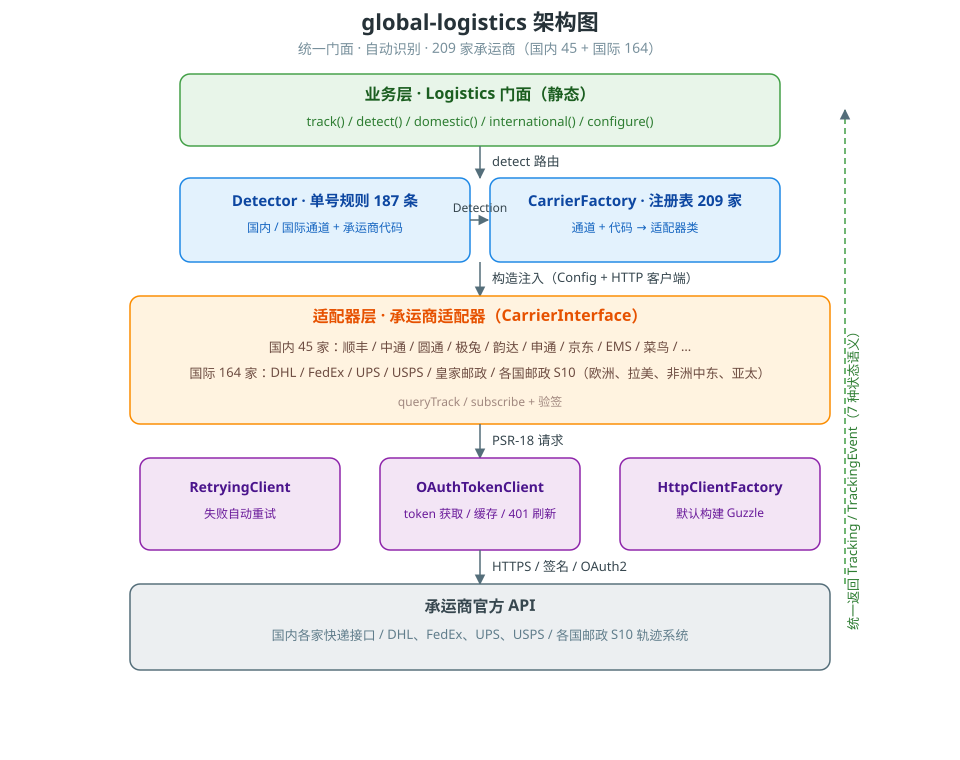
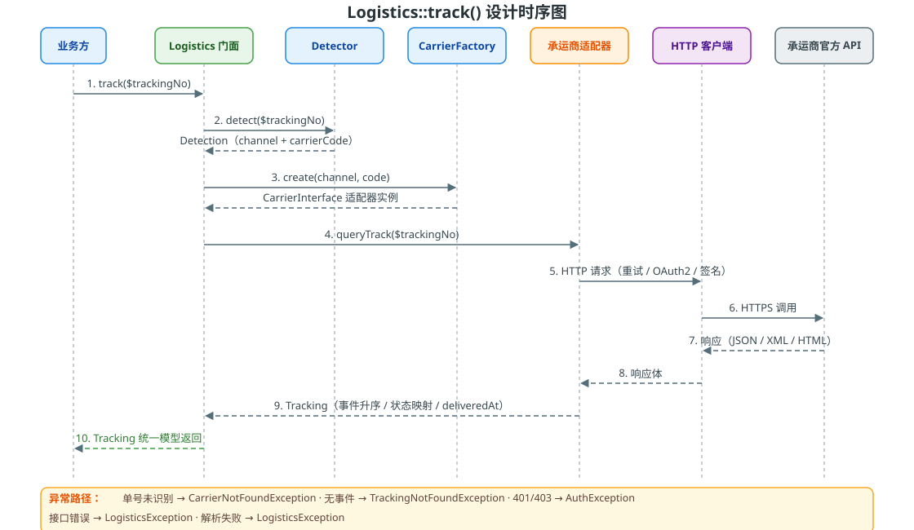

# global-logistics

A unified-facade composer package for domestic (China) express and international logistics tracking (PHP 8.2+, PSR-4, framework-agnostic).

[简体中文](README.md)

## About

**global-logistics** converges tracking for **209** express / postal carriers worldwide into a single facade: pass in a tracking number, and the channel (domestic / international) and carrier are detected automatically — no need to deal with per-carrier protocol differences (signatures, OAuth2, XML/JSON, status mapping).

| Metric | Value |
|---|---|
| Integrated carriers | **209** (45 domestic + 164 international) |
| Tracking-number detection rules | 187 (order-sensitive, first match wins) |
| International coverage | Big four express (DHL / FedEx / UPS / USPS) + national postal S10 systems (Europe, Latin America & Caribbean, Africa & Middle East, Asia-Pacific) |
| Unified status semantics | `TrackStatus` with 7 states (incl. exception / returned) |
| Tests | 1665 test cases / 6267 assertions, all green |
| Requirements | PHP 8.2+, PSR-4 / PSR-18, framework-agnostic; drop-in for Laravel / ThinkPHP / Hyperf / Webman / Yii 2 / Yii 3 |

## Overview

Built for e-commerce, warehousing, and ERP systems, it converges the official APIs of domestic express and international logistics into a single facade:

- **One entry point**: `Logistics::track($trackingNo)` auto-detects the channel and carrier — no need to know which carrier a number belongs to
- **One data model**: every carrier returns the same `Tracking` / `TrackingEvent` structure; the business layer deals with a single shape
- **One status semantic**: carriers' varied raw statuses map to a unified `TrackStatus` enum (7 states)
- **Global coverage**: 164 international carriers, incl. DHL / FedEx / UPS / USPS and national postal S10 systems (Europe, Latin America & Caribbean, Africa & Middle East, Asia-Pacific)
- **Zero hardcoded credentials**: all keys are injected via configuration; code and secrets are fully separated

## Features

### Integrated carriers (209)

| Channel | Carrier | Code | Tracking | Subscribe |
|---|---|---|---|---|
| Domestic | SF Express | `sf` | ✅ | ✅ |
| Domestic | ZTO Express | `zto` | ✅ | — |
| Domestic | YTO Express | `yto` | ✅ | — |
| Domestic | J&T Express | `jt` | ✅ | — |
| Domestic | Yunda Express | `yd` | ✅ | — |
| Domestic | STO Express | `sto` | ✅ | — |
| Domestic | JD Logistics | `jd` | ✅ | — |
| Domestic | EMS | `ems` | ✅ | — |
| Domestic | Best Express | `ht` | ✅ | — |
| Domestic | Deppon | `debon` | ✅ | — |
| Domestic | KuaYue Express | `ky` | ✅ | — |
| Domestic | Aneng Logistics | `ane` | ✅ | — |
| Domestic | Cainiao Express | `cainiao` | ✅ | — |
| Domestic | China Post | `china-post` | ✅ | — |
| Domestic | Suning Logistics | `suning` | ✅ | — |
| Domestic | UC Express | `uc` | ✅ | — |
| Domestic | Yimidida | `ymd` | ✅ | — |
| Domestic | ZJS Express | `zjs` | ✅ | — |
| Domestic | Tiantian Express | `tiantian` | ✅ | — |
| Domestic | ZTO Freight | `zto-freight` | ✅ | — |
| Domestic | Dainiao (Cainiao Direct) | `dainiao` | ✅ | — |
| Domestic | CRE Express | `cre` | ✅ | — |
| Domestic | Shunxin Jieda | `sxjd` | ✅ | — |
| Domestic | Sure Express | `sure` | ✅ | — |
| Domestic | Xinfeng Logistics | `xf` | ✅ | — |
| Domestic | Lianhaotong | `lht` | ✅ | — |
| Domestic | RRS Logistics | `rrs` | ✅ | — |
| Domestic | Fengwang Express | `fengwang` | ✅ | — |
| Domestic | Best Freight | `ht-freight` | ✅ | — |
| Domestic | Yunda Freight | `yd-freight` | ✅ | — |
| Domestic | YTO Freight | `yto-freight` | ✅ | — |
| Domestic | Zengyi Express | `zy` | ✅ | — |
| Domestic | CAE Express | `cae` | ✅ | — |
| Domestic | Tiandi Huayu | `huayu` | ✅ | — |
| Domestic | Jiaji Freight | `jiaji` | ✅ | — |
| Domestic | Longbang Express | `longbang` | ✅ | — |
| Domestic | Quanyi Express | `qy` | ✅ | — |
| Domestic | Suteng Logistics | `suteng` | ✅ | — |
| Domestic | Zhongtie Logistics | `zhongtie` | ✅ | — |
| Domestic | Zhongyou Logistics | `zhongyou` | ✅ | — |
| Domestic | Zengyi Express | `zengyi` | ✅ | — |
| Domestic | Quanfeng Express | `quanfeng` | ✅ | — |
| Domestic | Guotong Express | `guotong` | ✅ | — |
| Domestic | Yuancheng Freight | `yuancheng` | ✅ | — |
| Domestic | Xinbang Logistics | `xinbang` | ✅ | — |
| International | DHL | `dhl` | ✅ (OAuth2) | — |
| International | FedEx | `fedex` | ✅ (OAuth2) | — |
| International | UPS | `ups` | ✅ (OAuth2) | — |
| International | USPS | `usps` | ✅ | — |
| International | Royal Mail | `royal-mail` | ✅ (OAuth2) | — |
| International | Canada Post | `canada-post` | ✅ | — |
| International | Australia Post | `australia-post` | ✅ | — |
| International | Japan Post | `japan-post` | ✅ (no auth) | — |
| International | Aramex | `aramex` | ✅ | — |
| International | GLS | `gls` | ✅ | — |
| International | DPD | `dpd` | ✅ | — |
| International | PostNL | `postnl` | ✅ | — |
| International | Cainiao International | `cainiao-intl` | ✅ | — |
| International | Correios (Brazil) | `correios` | ✅ | — |
| International | Evri | `evri` | ✅ | — |
| International | 4PX | `fourpx` | ✅ | — |
| International | Hong Kong Post | `hong-kong-post` | ✅ | — |
| International | Kerry Express | `kerry` | ✅ | — |
| International | Korea Post | `korea-post` | ✅ | — |
| International | La Poste (France) | `la-poste` | ✅ | — |
| International | NZ Post | `nz-post` | ✅ | — |
| International | Poste Italiane | `poste-italiane` | ✅ | — |
| International | Russia Post | `russia-post` | ✅ | — |
| International | Singapore Post | `singapore-post` | ✅ | — |
| International | Swiss Post | `swiss-post` | ✅ (OAuth2) | — |
| International | Yodel | `yodel` | ✅ (OAuth2) | — |
| International | YunExpress | `yunexpress` | ✅ | — |
| International | Yanwen | `yanwen` | ✅ | — |
| International | SF International | `sf-international` | ✅ | — |
| International | TNT | `tnt` | ✅ | — |
| International | OnTrac | `ontrac` | ✅ | — |
| International | Purolator | `purolator` | ✅ | — |
| International | bpost (Belgium) | `bpost` | ✅ | — |
| International | Correos (Spain) | `correos` | ✅ | — |
| International | Delhivery (India) | `delhivery` | ✅ | — |
| International | InPost (Poland parcel lockers) | `inpost` | ✅ | — |
| International | Omniva (Estonia) | `omniva` | ✅ | — |
| International | Posti (Finland) | `posti` | ✅ | — |
| International | Bring (Norway) | `bring` | ✅ | — |
| International | Austrian Post | `austrian-post` | ✅ | — |
| International | Thailand Post | `thailand-post` | ✅ | — |
| International | Chunghwa Post (Taiwan) | `chunghwa-post` | ✅ | — |
| International | PostNord (Sweden/Denmark) | `postnord` | ✅ | — |
| International | CTT (Portugal) | `ctt` | ✅ | — |
| International | An Post (Ireland) | `an-post` | ✅ | — |
| International | Poczta Polska (Poland) | `poczta-polska` | ✅ | — |
| International | India Post | `india-post` | ✅ | — |
| International | Pos Malaysia | `pos-malaysia` | ✅ | — |
| International | Emirates Post (UAE) | `emirates-post` | ✅ | — |
| International | Magyar Posta (Hungary) | `magyar-posta` | ✅ | — |
| International | Česká pošta (Czech Republic) | `ceska-posta` | ✅ | — |
| International | ELTA (Greece) | `elta` | ✅ | — |
| International | Viettel Post (Vietnam) | `viettel-post` | ✅ | — |
| International | ZTO International | `zto-intl` | ✅ | — |
| International | YTO International | `yto-intl` | ✅ | — |
| International | J&T International | `jt-intl` | ✅ | — |
| International | Winit | `winit` | ✅ | — |
| International | Ukrposhta (Ukraine) | `ukrposhta` | ✅ | — |
| International | Turkey PTT | `turkey-post` | ✅ | — |
| International | Israel Post | `israel-post` | ✅ | — |
| International | Egypt Post | `egypt-post` | ✅ | — |
| International | Saudi Post | `saudi-post` | ✅ | — |
| International | South African Post | `south-african-post` | ✅ | — |
| International | Correos de México (Mexico) | `correos-mexico` | ✅ | — |
| International | Correo Argentino (Argentina) | `correo-argentino` | ✅ | — |
| International | Correos de Chile (Chile) | `correos-chile` | ✅ | — |
| International | Pos Indonesia | `pos-indonesia` | ✅ | — |
| International | PHLPost (Philippines) | `phl-post` | ✅ | — |
| International | Pakistan Post | `pakistan-post` | ✅ | — |
| International | Kazpost (Kazakhstan) | `kazpost` | ✅ | — |
| International | Poșta Română (Romania) | `romania-post` | ✅ | — |
| International | Hrvatska pošta (Croatia) | `croatia-post` | ✅ | — |
| International | Slovak Post | `slovak-post` | ✅ | — |
| International | Pošta Slovenije (Slovenia) | `slovenia-post` | ✅ | — |
| International | Pošta Srbije (Serbia) | `serbia-post` | ✅ | — |
| International | Bulgarian Posts | `bulgaria-post` | ✅ | — |
| International | Lietuvos paštas (Lithuania) | `lithuania-post` | ✅ | — |
| International | Latvijas Pasts (Latvia) | `latvia-post` | ✅ | — |
| International | Íslandspóstur (Iceland) | `iceland-post` | ✅ | — |
| International | MaltaPost | `malta-post` | ✅ | — |
| International | POST Luxembourg | `luxembourg-post` | ✅ | — |
| International | Cyprus Post | `cyprus-post` | ✅ | — |
| International | Poșta Moldovei (Moldova) | `moldova-post` | ✅ | — |
| International | Posta Shqiptare (Albania) | `albania-post` | ✅ | — |
| International | Belpochta (Belarus) | `belarus-post` | ✅ | — |
| International | Makedonska Pošta (North Macedonia) | `macedonia-post` | ✅ | — |
| International | BH Pošta (Bosnia and Herzegovina) | `bosnia-post` | ✅ | — |
| International | Deutsche Post (Germany) | `deutsche-post` | ✅ | — |
| International | Montenegro Post | `montenegro-post` | ✅ | — |
| International | Andorra Post | `andorra-post` | ✅ | — |
| International | La Poste Monaco | `monaco-post` | ✅ | — |
| International | Liechtenstein Post | `liechtenstein-post` | ✅ | — |
| International | Poste San Marino | `san-marino-post` | ✅ | — |
| International | Poste Vaticane (Vatican) | `vatican-post` | ✅ | — |
| International | Royal Gibraltar Post | `gibraltar-post` | ✅ | — |
| International | Jersey Post | `jersey-post` | ✅ | — |
| International | Guernsey Post | `guernsey-post` | ✅ | — |
| International | Isle of Man Post | `isle-of-man-post` | ✅ | — |
| International | Posta Faroe Islands | `faroe-post` | ✅ | — |
| International | Post Greenland | `greenland-post` | ✅ | — |
| International | Post Åland | `aland-post` | ✅ | — |
| International | 4-72 (Colombia) | `colombia-post` | ✅ | — |
| International | Serpost (Peru) | `peru-post` | ✅ | — |
| International | Correo Uruguayo (Uruguay) | `uruguay-post` | ✅ | — |
| International | Correo Paraguayo (Paraguay) | `paraguay-post` | ✅ | — |
| International | Correos de Bolivia (Bolivia) | `bolivia-post` | ✅ | — |
| International | Correos del Ecuador (Ecuador) | `ecuador-post` | ✅ | — |
| International | Ipostel (Venezuela) | `venezuela-post` | ✅ | — |
| International | Correos de Costa Rica (Costa Rica) | `costa-rica-post` | ✅ | — |
| International | Correos de Panamá (Panama) | `panama-post` | ✅ | — |
| International | INPOSDOM (Dominican Republic) | `dominican-post` | ✅ | — |
| International | Correo de Guatemala (Guatemala) | `guatemala-post` | ✅ | — |
| International | HonduCorreo (Honduras) | `honduras-post` | ✅ | — |
| International | Correos de El Salvador (El Salvador) | `el-salvador-post` | ✅ | — |
| International | Correos de Nicaragua (Nicaragua) | `nicaragua-post` | ✅ | — |
| International | Correos de Cuba (Cuba) | `cuba-post` | ✅ | — |
| International | Jamaica Post | `jamaica-post` | ✅ | — |
| International | TTPOST (Trinidad and Tobago) | `trinidad-post` | ✅ | — |
| International | Barbados Post | `barbados-post` | ✅ | — |
| International | Bahamas Post | `bahamas-post` | ✅ | — |
| International | Suriname Post | `suriname-post` | ✅ | — |
| International | Guyana Post | `guyana-post` | ✅ | — |
| International | Barid Al-Maghrib (Morocco) | `morocco-post` | ✅ | — |
| International | Algérie Poste (Algeria) | `algeria-post` | ✅ | — |
| International | La Poste Tunisienne (Tunisia) | `tunisia-post` | ✅ | — |
| International | Posta Kenya (Kenya) | `kenya-post` | ✅ | — |
| International | NIPOST (Nigeria) | `nigeria-post` | ✅ | — |
| International | Ethiopia Post | `ethiopia-post` | ✅ | — |
| International | Ghana Post | `ghana-post` | ✅ | — |
| International | Tanzania Post | `tanzania-post` | ✅ | — |
| International | Uganda Post | `uganda-post` | ✅ | — |
| International | Rwanda Post | `rwanda-post` | ✅ | — |
| International | Zampost (Zambia) | `zambia-post` | ✅ | — |
| International | Zimpost (Zimbabwe) | `zimbabwe-post` | ✅ | — |
| International | Mozambique Post | `mozambique-post` | ✅ | — |
| International | Correios de Angola (Angola) | `angola-post` | ✅ | — |
| International | La Poste Sénégalaise (Senegal) | `senegal-post` | ✅ | — |
| International | La Poste de Côte d'Ivoire (Ivory Coast) | `ivory-coast-post` | ✅ | — |
| International | Cameroon Post | `cameroon-post` | ✅ | — |
| International | Mauritius Post | `mauritius-post` | ✅ | — |
| International | Qatar Post | `qatar-post` | ✅ | — |
| International | Kuwait Post | `kuwait-post` | ✅ | — |
| International | Bahrain Post | `bahrain-post` | ✅ | — |
| International | Bangladesh Post | `bangladesh-post` | ✅ | — |
| International | Nepal Post | `nepal-post` | ✅ | — |
| International | Sri Lanka Post | `sri-lanka-post` | ✅ | — |
| International | Myanmar Post | `myanmar-post` | ✅ | — |
| International | Cambodia Post | `cambodia-post` | ✅ | — |
| International | Laos Post | `laos-post` | ✅ | — |
| International | Mongolia Post | `mongolia-post` | ✅ | — |
| International | Georgian Post | `georgia-post` | ✅ | — |
| International | Azərpoçt (Azerbaijan) | `azerbaijan-post` | ✅ | — |
| International | HayPost (Armenia) | `armenia-post` | ✅ | — |
| International | Uzbekistan Post | `uzbekistan-post` | ✅ | — |
| International | Kyrgyz Post (Kyrgyzstan) | `kyrgyzstan-post` | ✅ | — |
| International | Tajikistan Post | `tajikistan-post` | ✅ | — |
| International | Turkmenistan Post | `turkmenistan-post` | ✅ | — |
| International | Afghanistan Post | `afghanistan-post` | ✅ | — |
| International | Bhutan Post | `bhutan-post` | ✅ | — |
| International | Maldives Post | `maldives-post` | ✅ | — |
| International | Brunei Post | `brunei-post` | ✅ | — |
| International | Papua New Guinea Post | `papua-post` | ✅ | — |
| International | Fiji Post | `fiji-post` | ✅ | — |
| International | Samoa Post | `samoa-post` | ✅ | — |

### Unified status enum (`GlobalLogistics\Support\TrackStatus`)

`PENDING` → `IN_TRANSIT` → `OUT_FOR_DELIVERY` → `DELIVERED`; anomalies map to `EXCEPTION`, returns to `RETURNED`, unrecognized statuses to `UNKNOWN`.

### Core capabilities

- Auto-detection of tracking numbers (187 regex rules, order-sensitive, domestic rules take priority)
- Unified tracking (`Logistics::track()`) and explicit channel calls (`domestic()` / `international()`)
- Unified exception hierarchy (auth failure / tracking not found / network error / carrier not registered / API error)
- HTTP infrastructure: PSR-18 client, OAuth2 token auto-fetch & caching, automatic retry on failure
- Framework auto-discovery: Laravel / ThinkPHP 8 / Hyperf / Webman / Yii 2 / Yii 3, drop-in ready
- Callback signature verification (SF Express example: `verifyCallbackSignature()`)

## Usage

### Installation

```bash
composer require erikwang2013/global-logistics
```

### Configuration

```php
<?php

use GlobalLogistics\Logistics;

Logistics::configure([
    // Domestic
    'sf' => ['partner_id' => '...', 'checkword' => '...'],
    'zto' => ['company_id' => '...', 'secret' => '...'],
    'yto' => ['app_key' => '...', 'app_secret' => '...'],
    'jt' => ['api_key' => '...', 'secret' => '...'],
    'yd' => ['app_key' => '...', 'app_secret' => '...'],
    'sto' => [],
    'jd' => [],
    'ems' => ['app_id' => '...'],
    'ht' => ['partner_id' => '...', 'token' => '...'],
    'debon' => ['app_key' => '...', 'app_secret' => '...'],
    'ky' => ['app_key' => '...', 'app_secret' => '...'],
    'ane' => ['app_key' => '...'],
    // International
    'dhl' => ['client_id' => '...', 'client_secret' => '...'],
    'fedex' => ['client_id' => '...', 'client_secret' => '...'],
    'ups' => ['client_id' => '...', 'client_secret' => '...'],
    'usps' => ['user_id' => '...'],
    'royal-mail' => ['client_id' => '...', 'client_secret' => '...'],
    'canada-post' => ['customer_number' => '...', 'api_key' => '...'],
    'australia-post' => ['api_key' => '...'],
    'japan-post' => [],
    'aramex' => ['user_name' => '...', 'password' => '...', 'account_number' => '...'],
    'gls' => ['api_key' => '...'],
    'dpd' => ['user_name' => '...', 'password' => '...'],
    'postnl' => ['api_key' => '...'],

    // Optional: custom PSR-18 HTTP client (a Guzzle client is built automatically by default)
    'http_client' => null,
    // Optional: retry count on failure (default 2)
    'max_retries' => 2,
]);
```

> Framework projects (Laravel, etc.) can use the `config/logistics.php` template directly — see "Framework Integration".
>
> If `configure()` is never called, the facade auto-initializes with an empty config (only carriers that need no credentials are usable).

### Configuration reference

#### Top-level options

| Key | Type | Default | Description |
|---|---|---|---|
| `http_client` | PSR-18 client or `null` | `null` | Custom HTTP client; `null` auto-builds a Guzzle client |
| `max_retries` | int | `2` | Retry count for a failed request |
| `registry` | array | built-in 209-carrier registry | Custom "channel → code → adapter class" registry (advanced) |
| `detector_rules` | array | built-in 187 rules | Custom tracking-number detection rules (advanced) |

#### Credential field quick reference

Carriers use different auth methods, so field names vary. Common patterns:

| Field | Meaning | Typical carriers |
|---|---|---|
| `partner_id` + `checkword` | SF Express-style signing account & checkword | `sf`, `sf-international` |
| `company_id` + `secret` | ZTO-style company account & secret | `zto`, `zto-freight`, `zto-intl` |
| `app_key` + `app_secret` | Generic signing keys | `yto`, `yd`, `jt`, `debon`, `ky`, etc. |
| `ebusiness_id` + `app_key` | Kdniao API | `lht`, `rrs`, `sure`, `xf` and freight carriers |
| `client_id` + `client_secret` | OAuth2 client credentials (token auto-fetch & refresh) | `dhl`, `fedex`, `ups`, `royal-mail`, `swiss-post`, `yodel` |
| `user_id` / `api_key` / `key` | Carrier-issued account or key | `usps`, `postnl`, `gls`, `saudi-post`, etc. |
| `endpoint` | Custom API endpoint (optional; `''` uses the built-in official URL) | where supported |

> The exact keys each carrier needs are listed under its entry in `config/logistics.php`; carriers without auth can be left as empty arrays.

#### Obtaining credentials

- **Domestic carriers**: contact the carrier's business/technical contact to apply for a "tracking API" account (SF Fengqiao, ZTO open platform, etc.)
- **International carriers**: register developer accounts on the official portals of DHL / FedEx / UPS for OAuth2 credentials; apply for API keys on USPS, PostNL, etc. websites
- **National posts**: most expose public tracking APIs that need no credentials; apply in the post's developer center when a key is required

#### Carriers without credentials

These are ready to use with an empty array: domestic `sto`, `jd`; international `japan-post` and most national posts (`turkey-post`, `israel-post`, `egypt-post`, `south-african-post`, `phl-post`, `pakistan-post`, `kazpost`, etc.) — see `config/logistics.php`.

#### Credential security

Inject credentials via environment variables or the framework `.env` file instead of hard-coding them:

```php
Logistics::configure([
    'sf' => [
        'partner_id' => getenv('SF_PARTNER_ID'),
        'checkword' => getenv('SF_CHECKWORD'),
    ],
]);
```

### Tracking

```php
// Auto-detect the channel (domestic/international) and carrier
$tracking = Logistics::track('SF1234567890');

// Explicit carrier (when number rules cannot determine it)
$tracking = Logistics::domestic('sf')->queryTrack('SF1234567890');
$tracking = Logistics::international('dhl')->queryTrack('DHL1234567890');

echo $tracking->status->name;       // DELIVERED
echo $tracking->latestDescription;  // Package delivered
echo $tracking->carrierCode;        // sf
echo $tracking->deliveredAt?->format('Y-m-d H:i:s');  // delivery time (when delivered)

foreach ($tracking->events as $event) {
    echo $event->occurredAt?->format('Y-m-d H:i:s'), ' ', $event->location, ' ', $event->description, PHP_EOL;
}
```

### Error handling

All exceptions extend `GlobalLogistics\Exceptions\LogisticsException` and can be caught uniformly:

| Exception | Scenario |
|---|---|
| `CarrierNotFoundException` | Tracking number could not be matched to a carrier |
| `TrackingNotFoundException` | Valid number but the carrier has no tracking record |
| `AuthException` | Authentication failed (wrong credentials, etc.) |
| `NetworkException` | HTTP network error (implements PSR-18 `NetworkExceptionInterface`) |
| `LogisticsException` | Other API / parsing errors |

```php
use GlobalLogistics\Exceptions\LogisticsException;

try {
    $tracking = Logistics::track('SF1234567890');
} catch (LogisticsException $e) {
    // Log $e->getMessage(), which contains the carrier code and the original
    // error code, e.g. "[SF A1001] Required parameter cannot be empty"
}
```

### Callback signature verification (subscription push)

Example callback handler for carriers that expose a subscribe API (using SF Express):

```php
use GlobalLogistics\Logistics;

$carrier = Logistics::domestic('sf');
if (!$carrier->verifyCallbackSignature((string) file_get_contents('php://input'), (string) $_SERVER['HTTP_DIGEST'])) {
    http_response_code(401);
    exit('signature mismatch');
}
// Signature verified, handle the tracking push…
```

## Architecture





### Directory structure

```
global-logistics/
├── src/
│   ├── Carriers/
│   │   ├── Domestic/          # 45 domestic adapters (SF Express, ZTO, YTO, …)
│   │   └── International/     # 164 international adapters (DHL, FedEx, UPS, national postal S10, …)
│   ├── Exceptions/            # exception hierarchy (LogisticsException + 4 scenario exceptions)
│   ├── Framework/             # framework auto-discovery (Laravel / ThinkPHP / Hyperf / Webman / Yii 2; Yii 3 lives in config/params.php)
│   ├── Http/                  # PSR-18: OAuthTokenClient, RetryingClient, HttpClientFactory
│   ├── Models/                # Tracking / TrackingEvent
│   ├── Resources/             # carrier-registry.php (209 carriers), detector-rules.php (187 rules)
│   ├── Support/               # TrackStatus and other support classes
│   ├── CarrierFactory.php     # registry → adapter instantiation
│   ├── CarrierInterface.php   # unified adapter contract
│   ├── Channel.php            # domestic / international channel enum
│   ├── Config.php             # dot-notation config access
│   ├── Detection.php          # detection result
│   ├── Detector.php           # tracking-number rule detection
│   ├── Install.php            # installation bootstrap
│   └── Logistics.php          # static facade
├── config/
│   ├── logistics.php          # config template (credential placeholders for 209 carriers, shared)
│   ├── params.php             # Yii 3: defaults for the params group (requires logistics.php)
│   └── bootstrap.php          # Yii 3: callback for the bootstrap group, injects config at startup
├── docs/
│   ├── images/                # architecture / design sequence diagrams
│   └── superpowers/           # design specs and implementation plans
├── tests/
│   ├── Carriers/              # 209 carrier test suites
│   ├── Unit/                  # detector, registry smoke tests, etc.
│   └── fixtures/              # track / empty / error fixtures per carrier
├── composer.json
├── README.md
└── README.en.md
```

### Layer responsibilities

- **`Logistics`** (`src/Logistics.php`): static facade holding the global config, detector and factory; auto-initializes with an empty config when unconfigured
- **`Detector`** (`src/Detector.php` + `src/Resources/detector-rules.php`): regex rule table, first match wins, returns `Detection` (channel + carrier code); rules are order-sensitive (e.g. STO numbers starting with 77 must precede the generic 13-digit rule)
- **`CarrierFactory`** (`src/CarrierFactory.php` + `src/Resources/carrier-registry.php`): instantiates adapters from the "channel → code → adapter class" registry, uniformly injecting `Config` and the HTTP client
- **Carrier adapters** (`src/Carriers/`): implement `CarrierInterface` and handle per-carrier protocol differences (signatures, OAuth2, XML/JSON, status mapping); share a common template structure (`ENDPOINT` constant + `STATUS_MAP` + `mapEvent()`) so new carriers can be added from a template
- **HTTP layer** (`src/Http/`): `OAuthTokenClient` is a PSR-18 decorator that lazily fetches tokens, caches them in-process (expiring 60s early) and refreshes once on 401; `RetryingClient` retries failed requests per `max_retries`
- **Model layer** (`src/Models/`): `Tracking` / `TrackingEvent` are immutable
- **`Config`** (`src/Config.php`): dot-notation access (`$config->get('dhl.client_id')`)
- **Exceptions** (`src/Exceptions/`): `LogisticsException` is the base class, with 4 scenario exceptions

### Adding a new carrier

1. Create an adapter class (follow the `src/Carriers/Domestic/Yto.php` template): implement `CarrierInterface`, do the status mapping in `mapEvent()`
2. Registry: add "channel → code → class" to `src/Resources/carrier-registry.php`
3. Number rules: add a regex to `src/Resources/detector-rules.php` (mind order sensitivity — domestic rules first)
4. Add fixtures and adapter tests (mock HTTP, no real credentials needed)

## Framework Integration

After `composer require erikwang2013/global-logistics`, auto-discovery works per framework without manual registration (Yii 3 needs a one-time package-type opt-in in the app root `composer.json`, see below); the config template uses carrier codes as top-level keys (see `config/logistics.php`, same structure as the `Logistics::configure()` argument).

### Laravel

- Auto-registration: composer `extra.laravel.providers` package discovery, no configuration needed
- Publish config: `php artisan vendor:publish --tag=global-logistics` (generates `config/logistics.php`)
- Usage: `\GlobalLogistics\Logistics::track('SF1234567890')`

### ThinkPHP 8

- Auto-registration: composer `extra.think.services` (generates `vendor/services.php` on install; `php think service:discover` regenerates it)
- Config: the app's `config/logistics.php` returns a same-structure array (overrides package defaults)
- Usage: `\GlobalLogistics\Logistics::track('SF1234567890')`

### Hyperf

- Auto-discovery: composer `extra.hyperf.config` points to the ConfigProvider
- Publish config: `php bin/hyperf.php vendor:publish` (publishes to `config/autoload/logistics.php`)
- Usage: `\GlobalLogistics\Logistics::track('SF1234567890')`

### Webman

- Auto-install: webman project templates ship composer hooks like `post-package-install`; on install/update the config is copied to `config/plugin/erikwang2013/global-logistics/`, and removed on uninstall
- Read config: `config('plugin.erikwang2013.global-logistics.app.sf.partner_id')`
- Usage: `\GlobalLogistics\Logistics::track('SF1234567890')`

### Yii 2

- Auto-registration: package type `yii2-extension` + composer `extra.bootstrap`, runs on every app bootstrap
- Config: add `'logistics' => [...same-structure array...]` to the app config `params`
- Usage: `\GlobalLogistics\Logistics::track('SF1234567890')`
- If the package entry is missing from `vendor/yiisoft/extensions.php` (rare), run `composer dump-autoload` to rebuild

### Yii 3

Yii 3 merges each package's `config/` directory through the `yiisoft/config` composer plugin. This package declares `extra.config-plugin` for two groups: `params` and `bootstrap`.

- On first install, allow this package's type in the app root `composer.json` (the Yii 3 plugin only processes `library` / `composer-plugin` by default, while this package keeps `yii2-extension` for Yii 2 compatibility). If the app uses `extra.config-plugin-file` (e.g. `config/configuration.php`), add the same line to the `config-plugin-options` returned by **that** file instead:

  ```json
  "extra": {
      "config-plugin-options": {
          "package-types": ["library", "composer-plugin", "yii2-extension"]
      }
  }
  ```

- Then run `composer dump-autoload` to rebuild the merge plan (`config/.merge-plan.php`).
- Config: override by package name in the app's `config/common/params.php`. The params group replaces the whole entry per top-level key, so list only the carriers you need (omitted keys fall back to the defaults built into `Logistics::configure()`); omit the key entirely to keep the bundled defaults (209 placeholder carriers + `max_retries`)

  ```php
  return [
      'erikwang2013/global-logistics' => [
          'sf' => ['partner_id' => '...', 'checkword' => '...'],
          'dhl' => ['client_id' => '...', 'client_secret' => '...'],
      ],
  ];
  ```

- Auto-registration: the bundled `config/bootstrap.php` lands in the `bootstrap` group and runs `Logistics::configure()` on app startup (both web and console go through `$bootstrap`), no manual registration
- Usage: `\GlobalLogistics\Logistics::track('SF1234567890')`
- Without merging the package configs, wire it manually by calling `Logistics::configure([...])` from your own bootstrap callback — the argument shape is unchanged

## Development

```bash
composer install
composer test
```

The full test suite runs without real credentials (adapter tests use mock HTTP + fixtures; framework integration tests use real framework classes, with Yii 2 stubbed and Yii 3 replaying the yiisoft/config loading contract).
